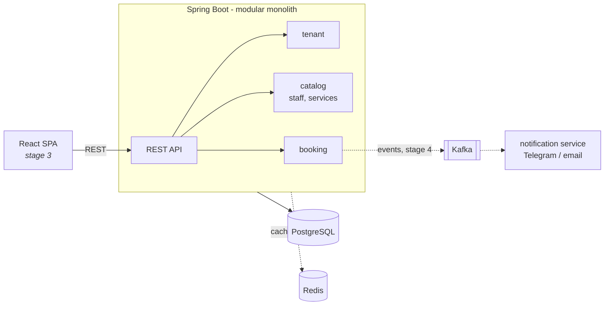

# Slotly

Multi-tenant booking & CRM platform for small service businesses: barbershops, beauty salons, tutors, clinics.
Each business (tenant) manages its staff and services; clients book time slots online.

> Status: **Stage 1 — core domain.** See [ROADMAP](docs/ROADMAP.md).

## Highlights

- **No double-booking, guaranteed by the database.** A PostgreSQL `EXCLUDE USING gist` constraint on
  `(staff_id, tstzrange(starts_at, ends_at))` rejects overlapping bookings atomically — no race window between
  "check availability" and "insert". Covered by a test that fires 10 concurrent requests at one slot and
  asserts exactly one wins.
- **Multi-tenancy** — every row is scoped by `tenant_id`; cross-tenant access returns 404.
- **Schema-first** — Flyway migrations, Hibernate in `validate` mode, explicit indexes for hot queries.
- **Errors as RFC 9457 Problem Details** (`application/problem+json`).
- **Real integration tests** against PostgreSQL in Testcontainers, not H2.

## Architecture



## Tech stack

Java 21 · Spring Boot 3.5 · Spring Data JPA · PostgreSQL 16 · Flyway · Testcontainers · Docker · GitHub Actions ·
OpenAPI (Swagger UI). Planned: Spring Security + JWT, Kafka, Redis, React + TypeScript, Prometheus + Grafana.

## Running locally

Requirements: JDK 21, Maven 3.9+, Docker.

```bash
docker compose up -d postgres
cd backend
mvn spring-boot:run
```

- Swagger UI: http://localhost:8080/swagger-ui.html
- Health: http://localhost:8080/actuator/health

Run everything in containers: `docker compose --profile app up --build`.

Tests (needs Docker running): `cd backend && mvn verify`.

## API example

```bash
# create a business
curl -X POST localhost:8080/api/v1/tenants -H "Content-Type: application/json" \
  -d '{"name":"Barber Bros","slug":"barber-bros"}'

# add a master and a service
curl -X POST localhost:8080/api/v1/tenants/1/staff -H "Content-Type: application/json" \
  -d '{"fullName":"Ivan Petrov"}'
curl -X POST localhost:8080/api/v1/tenants/1/services -H "Content-Type: application/json" \
  -d '{"name":"Haircut","durationMinutes":45,"price":1500}'

# book a slot (409 Conflict if it overlaps an existing booking)
curl -X POST localhost:8080/api/v1/tenants/1/bookings -H "Content-Type: application/json" \
  -d '{"staffId":1,"serviceId":1,"clientName":"Anna","clientPhone":"+79990001122","startsAt":"2026-12-01T10:00:00Z"}'
```

## Design decisions

| Decision | Why |
|---|---|
| Modular monolith over microservices | One deployable keeps the domain consistent and transactions simple; modules (`tenant`, `catalog`, `booking`) have clear boundaries and can be extracted later. Only notifications become a separate service, because they are naturally async. |
| Overlap check in the DB, not in Java | A `SELECT … then INSERT` check is racy under concurrency. The exclusion constraint is atomic and cannot be bypassed by another code path. |
| Shared schema with `tenant_id` | Cheapest multi-tenancy model to operate; isolation is enforced in every repository query (`findByIdAndTenantId`). Row-Level Security is on the roadmap as defence in depth. |
| `TIMESTAMPTZ` + `Instant` everywhere | Stores absolute moments; the tenant's timezone is applied only for display and working hours. |
